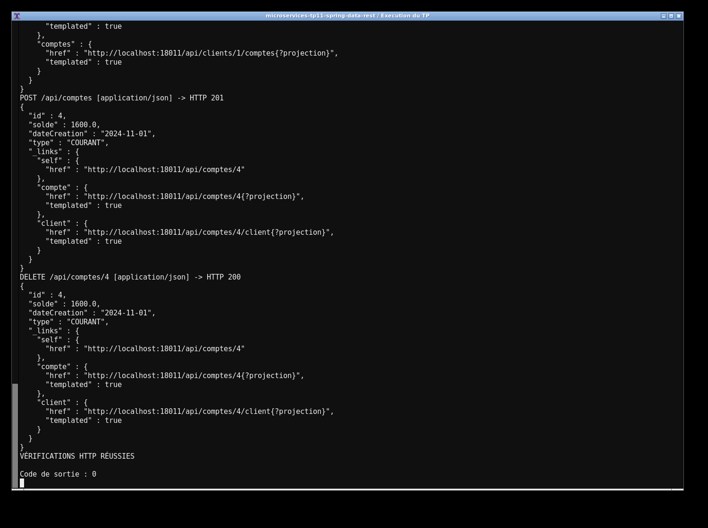
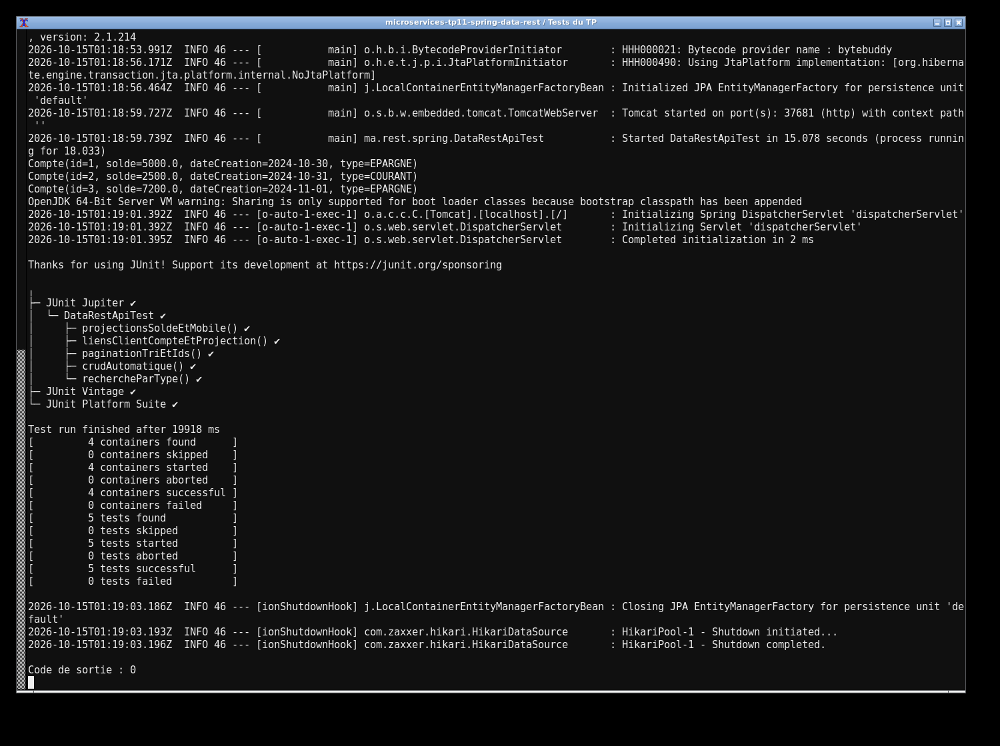

# TP11 — Spring Data REST

J'ai exposé les entités `Compte` et `Client` avec leurs repositories, sans contrôleur CRUD. Spring Data REST fournit les routes sous `/api`, les liens HATEOAS et les opérations de création, lecture, modification et suppression. H2 contient deux clients et trois comptes au démarrage.

J'utilise Java 17 et Maven. Pour lancer le projet :

```sh
mvn clean verify
mvn spring-boot:run
```

L'API est à `http://localhost:8082/api/comptes`. Les identifiants sont visibles. Les projections `solde`, `mobile` et `clientDetails` limitent les champs retournés. Pour filtrer : `/api/comptes/search/byType?t=EPARGNE`. Pour paginer et trier : `?page=0&size=2&sort=solde,desc`. Les liens `/api/clients/1/comptes` et `/api/comptes/1/client` permettent de naviguer dans l'association. Les tests vérifient les réponses HTTP réelles, les projections et les relations. La console H2 est disponible à `/h2-console`, avec `jdbc:h2:mem:banque` et l'utilisateur `sa`.

Les captures montrent l'exécution réelle du projet et des tests sur ma machine.



